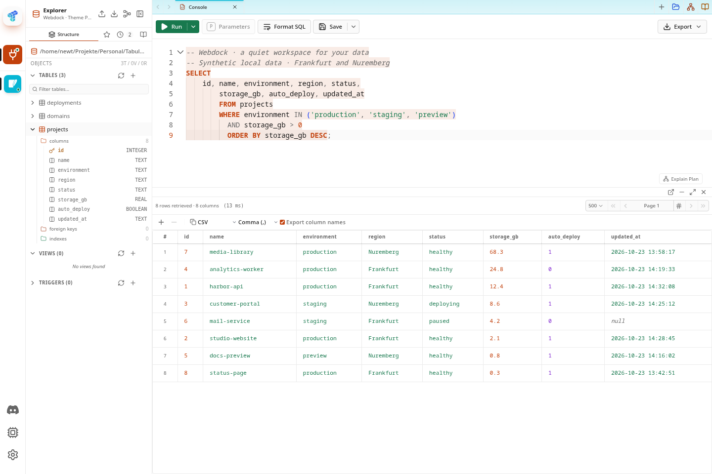
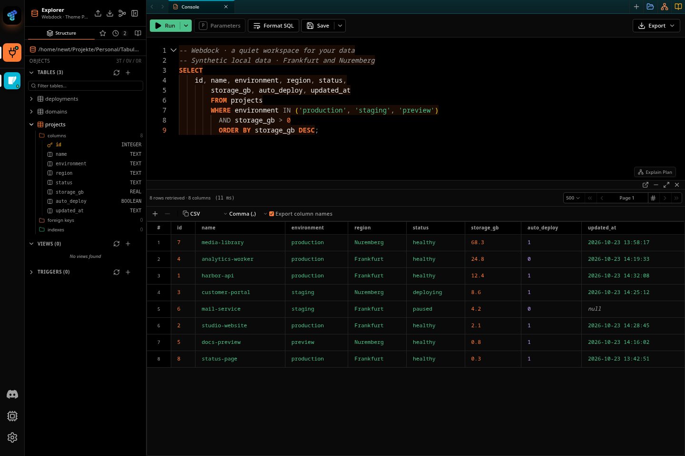

# Webdock for Tabularis

Two restrained themes based on the **Webdock Console**: white or true black
surfaces, neutral hairline borders, and a distinctive orange accent. The SQL
editor, result grid, dialogs, and status colors share the same palette.

Made by [Spitzli Development](https://spitzli.dev). Requires **Tabularis 0.26.0+**.
Works with the desktop application and **Tabularis Web**.

## Webdock Light



White canvas, soft gray navigation, dark orange actions, and clear dark text.

## Webdock Dark



True black canvas, near-black panels, bright orange actions, and soft white text.

Additional appearance views: [Light](screenshots/webdock-light-appearance.png) ·
[Dark](screenshots/webdock-dark-appearance.png).

Screenshots show the actual Tabularis Web interface with a local, synthetic
SQLite dataset. No customer data or production connections are used.

## Install locally

1. Build the package, or download `theme-universal.zip` from a published release.
2. Open **Settings → Appearance → Import theme → Local package**.
3. Select the ZIP, preview the variants, and click **Install**.
4. Close the dialog and select **Webdock Light** or **Webdock Dark**.

Installation adds both variants; it does not select one automatically. Set the
editor theme to **Same as App** for matching SQL colors. For automatic switching,
enable **Follow System** and choose the Webdock variant in each mode's picker.
In a web session, package installation requires local administrator capabilities.

## Build and validate

Node.js 22 is recommended. No dependency installation or account is required.

```sh
npm run validate
npm run check:contrast
npm run package
```

The bundled upstream tool validates the manifest and both JSON definitions, then
builds a deterministic, universal ZIP. It refuses to overwrite an existing ZIP;
remove the previous generated archive explicitly before rebuilding.

The archive contains only `.tabularium`, the declared theme JSON files, this
README, and the license. Screenshots, workflows, and authoring tools stay in the
repository. The theme contains no executable code, external stylesheets, remote
fonts, or database drivers.

## Design source

The palette comes directly from Webdock's `apps/console/src/styles.css`, with
corner radii informed by `apps/console/src/ui.ts`. It follows the application
console rather than the separate marketing website.

| Token | Light | Dark |
| --- | --- | --- |
| Canvas | `#ffffff` | `#000000` |
| Panel | `#ffffff` | `#0a0a0a` |
| Sidebar | `#fafafa` | `#000000` |
| Primary text | `#171717` | `#ededed` |
| Muted text | `#666666` | `#a1a1a1` |
| Default border | `#ebebeb` | `#242424` |
| Strong border | `#d6d6d6` | `#383838` |
| Accent | `#c2410c` | `#ff7a33` |
| Focus | `#c2511b` | `#ff8f52` |
| Success | `#18794e` | `#4cc38a` |
| Error | `#c62a2f` | `#ff6369` |

SQL syntax and data-type colors extend these tokens. Text is checked at 4.5:1
and focus indicators at 3:1 against the supported surfaces. Disabled controls
and decorative separators are excluded from the text contrast check.

The interface prefers locally installed **Inter Variable / Inter** with system
sans-serif fallbacks. Code uses the Webdock monospace stack, including JetBrains
Mono and DejaVu Sans Mono. Fonts are not included; Tabularis font preferences can
override the theme defaults. Radii are 4 / 6 / 8 / 12 px. This package changes
supported theme tokens, not Tabularis layout, icons, branding, or application code.

## Repository layout

```text
.tabularium                 Package identity and registry metadata
themes/light.json           Webdock Light and Monaco SQL colors
themes/dark.json            Webdock Dark and Monaco SQL colors
screenshots/                Actual Tabularis Web screenshots
tools/theme.mjs             Bundled upstream offline validator and packager
tools/check-contrast.mjs    Theme contrast checks
.github/workflows/          Validation and draft release automation
```

## Publish and submit when ready

The intended repository is **Spitzli/tabularis-webdock-theme**. The metadata
already points to that repository and its screenshot URLs; those URLs become
available after the source is pushed to its `main` branch.

1. Push the reviewed source to the intended repository.
2. Validate the release version: `node tools/theme.mjs validate . --tag v1.0.0`.
3. Push the matching `v1.0.0` tag. The release workflow creates a **draft** with
   `theme-universal.zip` and the manifest as release assets.
4. Review the ZIP and draft, then publish the release yourself.
5. Submit the repository at [registry.tabularis.dev/submit](https://registry.tabularis.dev/submit).

A GitHub release does not automatically submit or approve a registry entry.
Keep package ID `webdock-theme` and variant IDs `light` / `dark` stable in updates.
Increase the version before publishing changes.

## License and credits

Theme definitions, documentation, and screenshots: **MIT**, Spitzli Development.
Webdock and Spitzli names remain the property of their respective owners.

`tools/theme.mjs` is the bundled authoring tool from
[@tabularis/create-plugin](https://github.com/TabularisDB/tabularis/tree/main/packages/create-plugin)
0.4.2, licensed under Apache-2.0. Its license and bundled dependency notices are
preserved alongside it. See the
[Tabularis theme guide](https://tabularis.dev/wiki/themes) for the host contract.
